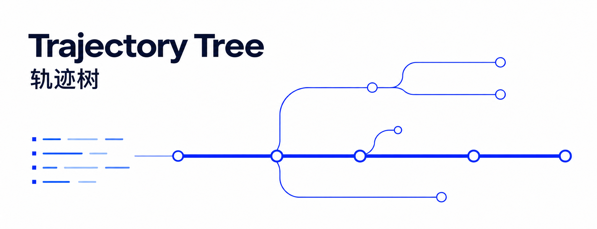
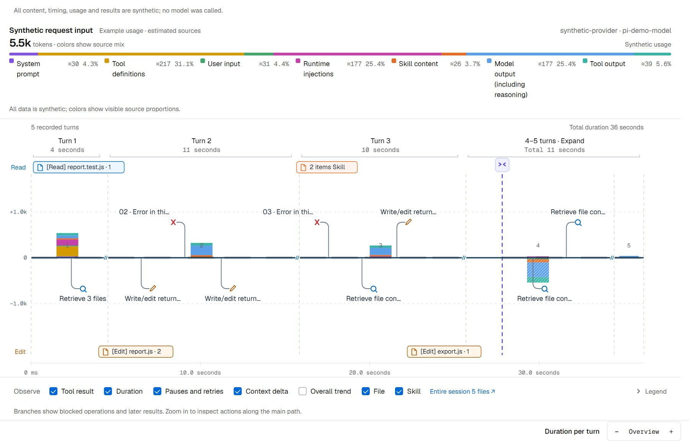
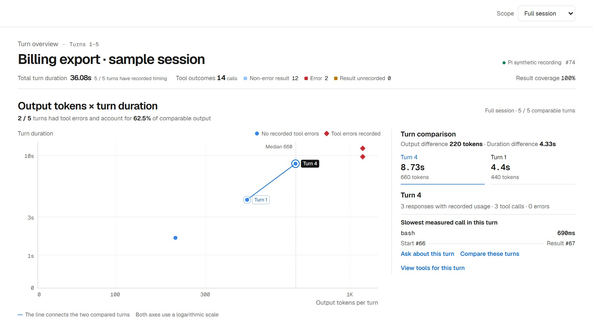
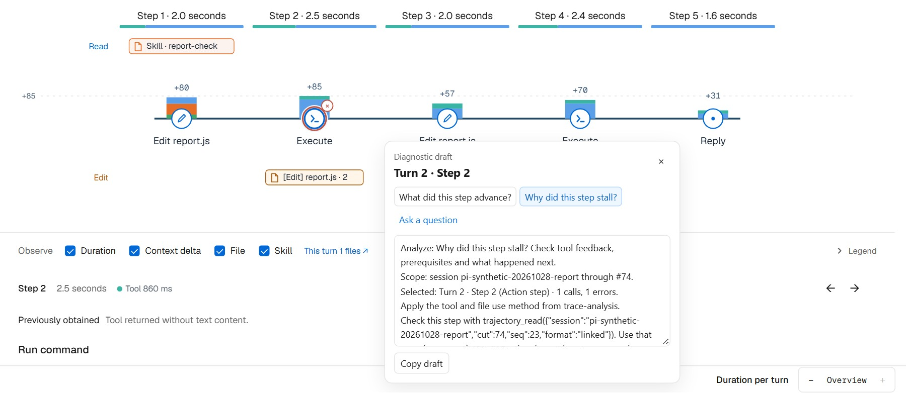

<h1 align="center"></h1>

<p align="center"><strong>See how your agent gets the work done.</strong></p>
<p align="center">Trajectory tree · Eval · Diagnosis from a selection · Visual reports</p>

<p align="center">
  <a href="README.md">中文</a> ·
  <a href="#quick-start">Quick start</a> ·
  <a href="docs/host-entrypoints.md">Host setup</a> ·
  <a href="LICENSE">MIT License</a>
</p>

<p align="center"><code>DSH</code> &nbsp; <code>Pi</code> &nbsp; <code>Codex</code> &nbsp; <code>Claude Code</code></p>

> The screenshots use the same public synthetic session. See the [media notes](docs/media/README.md).

## Trajectory tree

Start with the session's main path, then open any turn to inspect tool arguments, results, file changes and context deltas.



## Eval

Eval uses the same trace data as the trajectory tree. Compare turn duration with output tokens, see which tools take the most time, and spot recurring errors. Switch between the full session and an individual turn. Charts indicate how much of the session was measured.



## Diagnose a selection

In the DSH tree, hold to select an item or hold and drag to select a region. Context change bars are selectable too. In Eval, start from the chart details, including DSH tool sources and calls. Pick a question to get an editable draft with the session, selection and evidence queries. Review it before sending.



<details>
<summary>More examples: context and reports</summary>

- [Context trends](docs/media/context-trend.jpg) show retained material and per-turn changes by source.
- [Context assembly](docs/media/context-assembly.gif) replays appends, retention and rewrites.
- [Diagnostic report](docs/media/diagnostic-report.jpg) combines AI-authored findings with the charts and original records.

</details>

## Quick start

Run commands from the repository root. The plugin packages declare Node.js 18+, but DSH 0.2.2 and later require Node.js 24.9+ for the host itself; other hosts and standalone views require Node.js 20+.

<details>
<summary><strong>DSH · Native plugins and analysis panel</strong></summary>

```sh
npm pack ./plugin/trajectory-tools
npm pack ./plugin/analysis-view
dsh plugin --profile web add ./dsh-trajectory-tools-0.6.5.tgz ./dsh-analysis-view-0.10.144.tgz
```

Restart `dsh web`, then open **Eval** or use `/trajectory` for the current session's path. Choose a diagnostic question and select **Fill conversation** to append the draft to the composer. The plugins target the DSH 0.2.2 line; see the [host compatibility notes](docs/host-compatibility.md#dsh-version).

Select a goal line in the overview to open that goal. Select an event marker to inspect that change and open the associated turn in the action path or conversation.

Optionally install [Conversation search](plugin/conversation-search/README.md) to search the full session, load older matches, and jump to a turn from the right sidebar. DSH on-demand interpretation calls the current model. Disable the default post-compaction check-in with `config.reconcile: false`.

[Analysis panel](plugin/analysis-view/README.md) · [Evidence tools](plugin/trajectory-tools/README.md)

</details>

<details>
<summary><strong>Pi · Selected branch and native command</strong></summary>

```sh
npm ci --prefix plugin/portable-tools --ignore-scripts
pi -e ./plugin/portable-tools
```

Use `/trajectory` for the selected branch or `/trajectory --eval` for Eval. Copy the Pi draft command back into the terminal. If the editor already contains a draft, copy the prompt text and merge it yourself. Use `trace-analysis` for the session process and `context-profile` for current context and tool configuration.

[Pi setup](plugin/portable-tools/README.md#pi)

</details>

<details>
<summary><strong>Codex · Plugin, MCP and standalone views</strong></summary>

```sh
npm ci --prefix plugin/portable-tools --ignore-scripts
node scripts/sync-host-skills.mjs
node scripts/package-trajectory.mjs --host codex
```

Install `dist/trajectory-tree-codex` from the local plugin directory. Use `$trajectory-view` for the tree, `$trajectory-eval` for Eval, or `$trace-analysis` and `$context-profile` for analysis. Copy an Eval draft back into the Codex composer.

Generate a view directly for the current session; local session reads require the official `codex app-server`:

```sh
node scripts/trajectory-view.mjs --host codex --serve
```

Open **Compare changes** from an action or file history to switch between changed files, read added and removed lines with the recorded line numbers, or see the raw patch.

[Plugin entry points](docs/host-entrypoints.md) · [Codex / MCP setup](plugin/portable-tools/README.md#codex)

</details>

<details>
<summary><strong>Claude Code · Native plugin and transcript</strong></summary>

```sh
npm ci --prefix plugin/portable-tools --ignore-scripts
node scripts/sync-host-skills.mjs
node scripts/package-trajectory.mjs --host claude
claude --plugin-dir ./dist/trajectory-tree-claude
```

Use `/trajectory-tree:trajectory-view` or `/trajectory-tree:trajectory-eval` to open a view, then copy a diagnosis draft back into Claude Code. The plugin provides the current transcript path at session startup, resume and related lifecycle events.

[Claude Code setup](plugin/claude/README.md)

</details>

### Generate an offline view

```sh
node scripts/trajectory-view.mjs --host pi --file /absolute/session.jsonl --open
node scripts/trajectory-view.mjs --host claude --file /absolute/transcript.jsonl --eval --lang en --open
```

Generation does not call a model. The command returns a standalone HTML file and a local preview URL; fonts are embedded for offline viewing.

The trajectory tree, Eval and diagnostic drafts follow the host or browser language. Choose Auto / 中文 / English in the tree, or pass `--lang en` or `--lang zh-CN` for a standalone view. Quoted logs, paths and arguments keep their original text. See [host compatibility and language selection](docs/host-compatibility.md) for available evidence and supported capabilities.

## One set of evidence tools

| Tool | Purpose |
| --- | --- |
| `trajectory_inspect` | Inspect the process, latency, usage, repeated attempts, tools/files and context |
| `trajectory_search` | Locate sessions, literal records and statistical scopes |
| `trajectory_read` | Read originals, connected actions and feedback; continue through full arguments and results |
| `trajectory_graph` | Inspect record relations and session lineage |

Use `outcome` to filter calls by result. This query counts recorded errors by tool. Use `abnormal` to also include calls with an unconfirmed result.

```json
{"view":"io","groupBy":"tool","outcome":"error","sort":"count"}
```

Queries are read-only. Each host exposes its recorded evidence; missing content remains unknown.

| Host | Main data sources |
| --- | --- |
| DSH | Native events, official statistics, context composition, files, Skills and subagents |
| Pi | Selected branch, current SDK configuration and captured execution timing |
| Codex | Official session APIs and matching local thread records |
| Claude Code | An explicitly selected transcript, native tool arguments/results and recorded message usage |

## Documentation

- [Repository index](docs/INDEX.md)
- [Host setup and commands](docs/host-entrypoints.md)
- [Tool configuration, queries and continued reads](plugin/portable-tools/README.md)
- [Analysis methods](skill/trace-analysis/SKILL.md) · [Context and configuration profile](skill/context-profile/SKILL.md)
- [HTML report components](report/AUTHORING.md)

<details>
<summary>Development and checks</summary>

```sh
node scripts/sync-host-skills.mjs --check
node scripts/sync-view-assets.mjs --check
npm test --prefix plugin/trajectory-tools
npm test --prefix plugin/portable-tools
node plugin/analysis-view/presentation-test.mjs
node plugin/analysis-view/perf-test.mjs
```

`plugin/` provides host integrations, `analyzers/` reads native records, and `view/` plus `report/` provide visualizations. Recreate the public showcase pages with `node scripts/build-readme-media.mjs --serve 3099`.

</details>

## License

[MIT](LICENSE) © 2026 goatliamia
