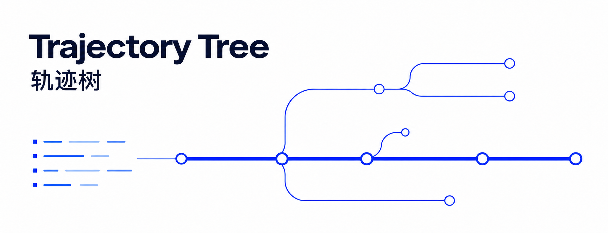
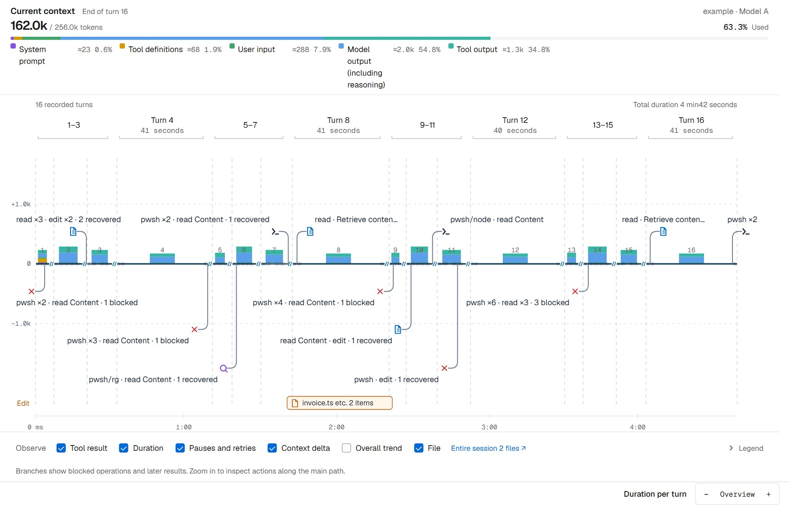
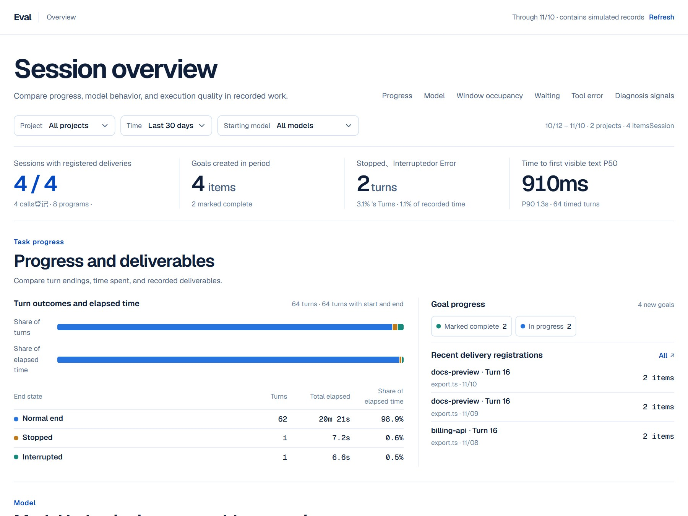
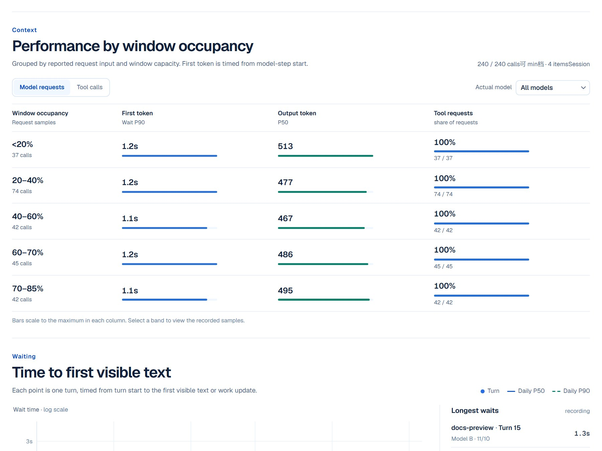
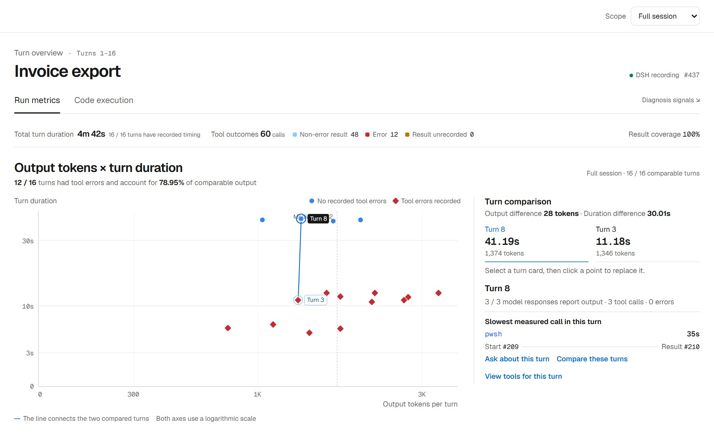
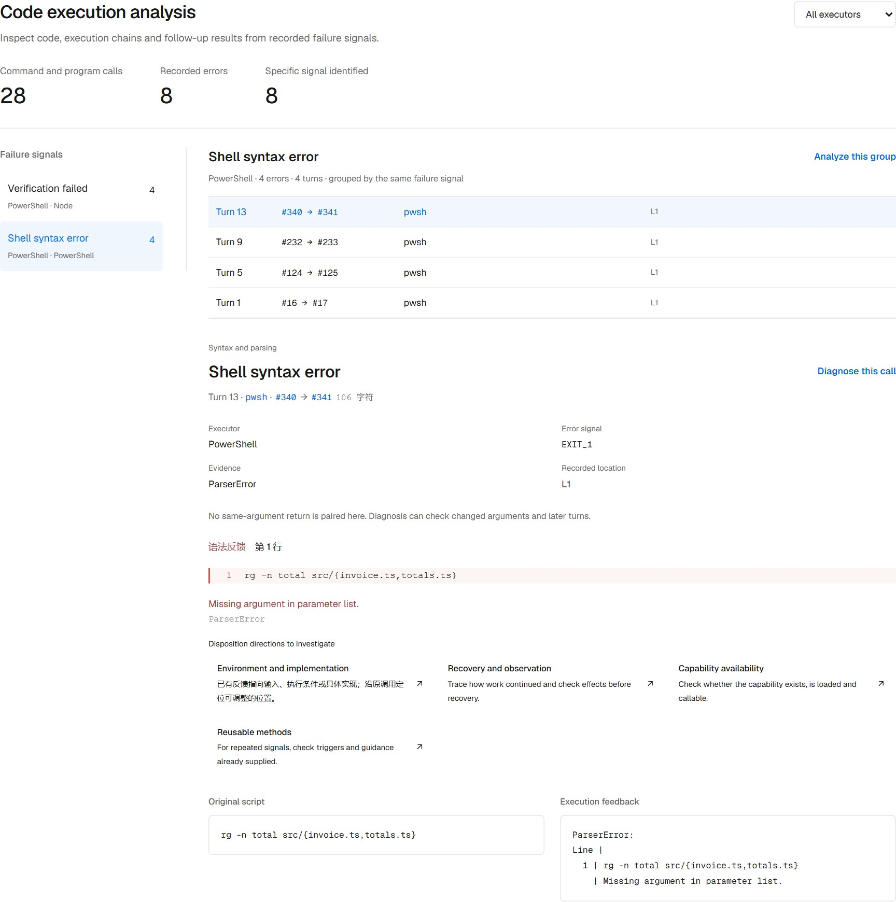
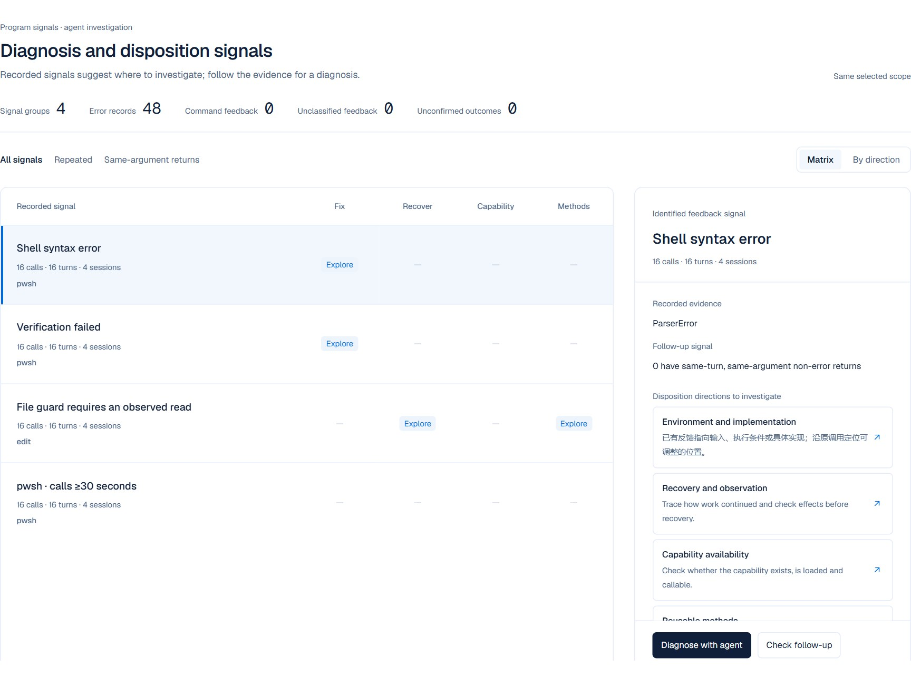
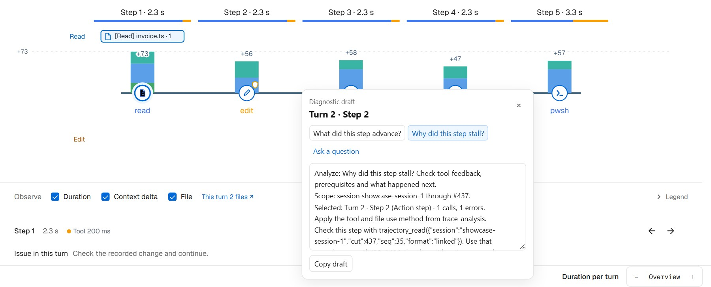
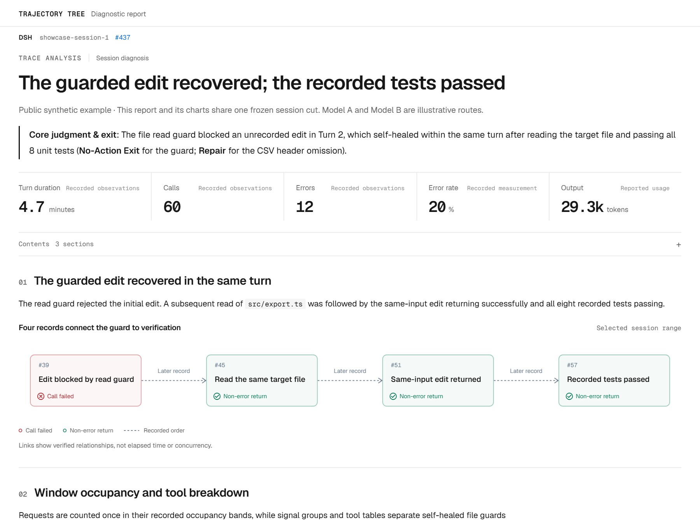

<h1 align="center"></h1>

<p align="center"><strong>See how your agent gets the work done.</strong></p>
<p align="center">Trajectory tree · Eval · Diagnosis from a selection · Visual reports</p>

<p align="center">
  <a href="README.md">中文</a> ·
  <a href="#quick-start">Quick start</a> ·
  <a href="docs/host-entrypoints.md">Host setup</a> ·
  <a href="LICENSE">MIT License</a>
</p>

<p align="center"><code>DSH</code> &nbsp; <code>Pi</code> &nbsp; <code>Codex</code> &nbsp; <code>Claude Code</code></p>
<p align="center"><a href="#antigravity"><code>Antigravity · Context sidebar</code></a></p>

> Screenshots use reproducible public synthetic examples, with no private conversations. Model A / B illustrate comparisons. [Media and reproduction](docs/media/README.md)

## Trajectory tree

Unfold the session into branches of tools and actions. Open any turn to inspect arguments, results, file changes, subagent relations and context deltas, then follow the linked records to see how the task progressed.

- **Per-call measures and error code frames**: Writes and edits compute added/removed line counts (`measure`), while failed calls pinpoint source lines and columns with surrounding code excerpts (`codeFrames`).
- **Approval and policy control markers**: The main trunk and step details surface approval rejections, read/version guards (`FS_NOT_OBSERVED` / `FS_STALE_VERSION`), worktree isolation boundaries (`HOST_WORKTREE_GUARD`), timeouts and same-input retries (`controls`).
- **Current context sidebar (DSH)**: A right-hand sidebar displays currently retained context across seven categories as a continuous zoomable treemap, respecting post-compaction surfaces and loading full text on demand.



## Eval and configuration management

Eval extracts metrics from everyday tasks using the same trace data and cut as the tree. No separate benchmark is required. Session Eval compares turn timing, output, tool latency and errors; the project overview brings together preset configuration, Skill usage, task progress, model behavior and signals across sessions.

- **Zoomable treemap**: Compare the size and read frequency of system prompts, project instructions, tool definitions, Skill catalog entries and loaded bodies with pointer-anchored zoom, double-click focus and in-place detail drawers.
- **Capability management and context overlap**: Enable or disable Skills per preset with reversible overrides and cache-impact previews; automatically detect exact 64-character winnowing overlaps across system prompts, `AGENTS.md`, tool descriptions and Skills with shared quotes, coverage ratios and `L1 ↔ L2` line comparisons.
- **Window occupancy and unified disposition matrix**: Drag or click `5%` window occupancy bins to encode feedback counts, window distributions, call latency and request wait times directly across the four disposition directions.



<details>
<summary>Window occupancy comparisons and session metrics</summary>





</details>

## Follow a failure signal to its execution

**Code execution** brings PowerShell, Bash, child-program and PTC code together with host outcomes and feedback. Filter by executor or signal to inspect script positions, evidence, parent/child calls and later returns, backed by PowerShell AST and Bash `noexec` static syntax checks.



| Case | Evidence to inspect |
| --- | --- |
| PowerShell / Bash syntax or argument error | Original script, static/runtime parser location, outer exit code and specific feedback |
| Edit blocked by a file guard or worktree boundary | Control signal (`controls`), target file, later read, same-input edit return and verification |
| A failed PTC child call | Outer program, inner tool and their respective outcomes and code frames |
| More errors at high window occupancy | Samples and error distributions for the same model, tool and occupancy band |

## Diagnose a selection with explicit exits

In the tree, hold to select an item or hold and drag to select a region. Context change bars are selectable too. In Eval, start from the unified disposition matrix, code execution or context overlap view. Pick a question to get an editable draft with the session, selection, overlap excerpts (with line ranges and coverage) and evidence queries.

The diagnosis skills (`trace-analysis` and `context-profile`) converge directly on five actionable exits:

| Diagnostic exit | Condition and action |
| --- | --- |
| **No action needed** | E.g., `FS_NOT_OBSERVED` was resolved in the same turn by reading the file and succeeding with identical parameters, or a probe command returned an expected miss |
| **Repair implementation or environment** | Pinpoint the code, script syntax, parameter contract, path or config defect and re-verify on the original execution chain |
| **Recover observation and re-run** | Check workspace and background process state after a timeout, user stop, unpersisted result or stale file version before resuming |
| **Enable or disable capabilities** | Explain the tool's responsibilities, primary use cases and low-frequency fallback uses, align with user needs, and toggle via configuration only — **never modify the source code, schema or built-in description of official host tools** |
| **Retain knowledge and deduplicate** | Route persistent cross-task rules to `AGENTS.md` / `CLAUDE.md`, and sink task-specific workflows or long reference guides into on-demand `SKILL.md` / `references/` |



<details>
<summary>An action-path selection and editable diagnosis draft</summary>



</details>

## Deliver the investigation as a report

Reports follow a **Vercel Geist** open-canvas and `1px` hairline layout, compiling reviewed conclusions, 11 synchronized Eval tables from the same cut (including `findings` disposition groups and `code-execution`), and original evidence into a standalone offline HTML file. Full-width lead conclusions pair with 2-column compact charts, full-width evidence-bound flowcharts (`flow`), and on-demand evidence readout bars.



<details>
<summary>More examples: context retention and assembly</summary>

- [Context trends](docs/media/context-trend.jpg) show retained material and per-turn changes by source.
- [Context assembly](docs/media/context-assembly.gif) replays appends, retention and rewrites.
- [Report components and authoring](report/AUTHORING.md): evidence bindings, flows, composition, distributions and trends.

</details>

## Quick start

Run commands from the repository root. The plugin packages declare Node.js 18+, but DSH 0.2.2 and later require Node.js 24.9+ for the host itself; other hosts and standalone views require Node.js 20+.

| Host | Session Eval | Project overview | Code execution |
| --- | --- | --- | --- |
| DSH | Evaluation panel in the conversation | Eval overview in the left sidebar | Evaluation → Code execution |
| Pi | `/trajectory --eval` | `/trajectory --overview` | `/trajectory --code` |
| Codex | `$trajectory-eval` | `$trajectory-eval --overview` | `$trajectory-eval --code` |
| Claude Code | `/trajectory-tree:trajectory-eval` | `/trajectory-tree:trajectory-eval --overview` | `/trajectory-tree:trajectory-eval --code` |

The trajectory generation entry in Pi, Codex and Claude Code also accepts `--eval`, `--overview` or `--code`. DSH uses its persistent panels. [All host entry points](docs/host-entrypoints.md)

Antigravity has a separate [context and usage frontend plugin](plugin/antigravity/README.md). It reads the latest request's recorded system sections, tool definitions and messages into the shared seven-category zoomable treemap. Visible text estimates remain separate from reported usage. This integration adds a frontend only, with no tools or skills.

<details>
<summary><strong>DSH · Native plugins and analysis panel</strong></summary>

```sh
npm pack ./plugin/trajectory-tools
npm pack ./plugin/analysis-view
dsh plugin --profile web add ./dsh-trajectory-tools-0.6.9.tgz ./dsh-analysis-view-0.11.1.tgz
```

Restart `dsh web`, then open **Eval** or use `/trajectory` for the current session's path. Choose a diagnostic question and select **Fill conversation** to append the draft to the composer. The plugins target the DSH 0.2.2 line; see the [host compatibility notes](docs/host-compatibility.md#dsh-version).

Open **Eval overview** in the local DSH Web left sidebar to compare progress, model behavior, and tool errors across projects. The context section compares request and tool metrics by window occupancy.

Select a goal line in the overview to open that goal. Select an event marker to inspect that change and open the associated turn in the action path or conversation.
Trajectory Tree estimates seven categories of request context from DSH session records and shows changes by turn and step. Eval and the evidence tools share the samples. Reported input is shown separately.

Open **Trajectory Tree** in DSH's plugin manager to configure right-sidebar conversation search, default trace layers, and the Eval tool sort. Search starts enabled and covers the full session. Load older matches and select a result to jump to its turn. DSH on-demand interpretation calls the current model. Disable the default post-compaction check-in with `config.reconcile: false`.

[Analysis panel](plugin/analysis-view/README.md) · [Evidence tools](plugin/trajectory-tools/README.md)

</details>

<details>
<summary><strong>Pi · Selected branch and native command</strong></summary>

```sh
npm ci --prefix plugin/portable-tools --ignore-scripts
pi -e ./plugin/portable-tools
```

Use `/trajectory` for the selected branch or `/trajectory --eval` for Eval. Copy the Pi draft command back into the terminal. If the editor already contains a draft, copy the prompt text and merge it yourself. Use `trace-analysis` for the session process and `context-profile` for current context and tool configuration.

[Pi setup](plugin/portable-tools/README.md#pi)

</details>

<details>
<summary><strong>Codex · Plugin, MCP and standalone views</strong></summary>

```sh
npm ci --prefix plugin/portable-tools --ignore-scripts
node scripts/sync-host-skills.mjs
node scripts/package-trajectory.mjs --host codex
```

Install `dist/trajectory-tree-codex` from the local plugin directory. Use `$trajectory-view` for the tree, `$trajectory-eval` for Eval, or `$trace-analysis` and `$context-profile` for analysis. Copy an Eval draft back into the Codex composer.

Generate a view directly for the current session; local session reads require the official `codex app-server`:

```sh
node scripts/trajectory-view.mjs --host codex --serve
```

Use `trajectory_command_diagnose` to inspect a command failure at the same log cut. Optional syntax inspection supports Windows PowerShell 5.1 and PowerShell 7. [Command diagnostics setup](docs/host-entrypoints.md#命令诊断)

Open **Compare changes** from an action or file history to switch between changed files, read added and removed lines with the recorded line numbers, or see the raw patch.

[Plugin entry points](docs/host-entrypoints.md) · [Codex / MCP setup](plugin/portable-tools/README.md#codex)

</details>

<details>
<summary><strong>Claude Code · Native plugin and transcript</strong></summary>

```sh
npm ci --prefix plugin/portable-tools --ignore-scripts
node scripts/sync-host-skills.mjs
node scripts/package-trajectory.mjs --host claude
claude --plugin-dir ./dist/trajectory-tree-claude
```

Use `/trajectory-tree:trajectory-view` or `/trajectory-tree:trajectory-eval` to open a view, then copy a diagnosis draft back into Claude Code. The plugin provides the current transcript path at session startup, resume and related lifecycle events.

[Claude Code setup](plugin/claude/README.md)

</details>

<a id="antigravity"></a>
<details>
<summary><strong>Antigravity · Context and usage frontend</strong></summary>

```sh
node scripts/install-antigravity.mjs
```

Requires Node.js 24+. Refresh plugins or restart the host, then open **上下文与用量** from the conversation header's `+` menu. Zoom, pan, search and load exact source text on demand. Request trends compare recorded input, cache and output. Polling pauses while the page is hidden.

[Installation, data semantics and maintenance](plugin/antigravity/README.md)

</details>

### Generate an offline view

```sh
node scripts/trajectory-view.mjs --host pi --file /absolute/session.jsonl --open
node scripts/trajectory-view.mjs --host claude --file /absolute/transcript.jsonl --eval --lang en --open
```

Generation does not call a model. The command returns a standalone HTML file and a local preview URL; fonts are embedded for offline viewing.

The trajectory tree, Eval and diagnostic drafts follow the host or browser language. Choose Auto / 中文 / English in the tree, or pass `--lang en` or `--lang zh-CN` for a standalone view. Quoted logs, paths and arguments keep their original text. See [host compatibility and language selection](docs/host-compatibility.md) for available evidence and supported capabilities.

## One set of evidence tools

| Tool | Purpose |
| --- | --- |
| `trajectory_inspect` | Inspect the process, latency, usage, repeated attempts, tools/files (including per-call `measure`, `codeFrames` and `controls`) and context |
| `trajectory_search` | Locate sessions, literal records and statistical scopes |
| `trajectory_read` | Read originals, connected actions and feedback; continue through full arguments and results |
| `trajectory_graph` | Inspect record relations and session lineage |

Use `outcome` to filter calls by result. This query counts recorded errors by tool. Use `abnormal` to also include calls with an unconfirmed result.

```json
{"view":"io","groupBy":"tool","outcome":"error","sort":"count"}
```

Queries are read-only. Each host exposes its recorded evidence; missing content remains unknown.

| Host | Main data sources |
| --- | --- |
| DSH | Native events, official statistics, context composition, files, Skills and subagents |
| Pi | Selected branch, current SDK configuration and captured execution timing |
| Codex | Official session APIs and matching local thread records |
| Claude Code | An explicitly selected transcript, native tool arguments/results and recorded message usage |

## Documentation

- [Feature index](docs/INDEX.md) · [Code map](docs/code-map.md) · [Design archive](docs/archive/README.md)
- [Host setup and commands](docs/host-entrypoints.md)
- [Tool configuration, queries and continued reads](plugin/portable-tools/README.md)
- [Analysis methods](skill/trace-analysis/SKILL.md) · [Context and configuration profile](skill/context-profile/SKILL.md)
- [HTML report components](report/AUTHORING.md)

<details>
<summary>Development and checks</summary>

```sh
node scripts/sync-host-skills.mjs --check
node scripts/sync-view-assets.mjs --check
node --test test/hygiene-test.mjs test/complexity/code-status-test.mjs
node report/smoke-test.mjs
npm test --prefix plugin/trajectory-tools
npm test --prefix plugin/portable-tools
node plugin/analysis-view/presentation-test.mjs
node plugin/analysis-view/perf-test.mjs
```

`plugin/` provides host integrations, `analyzers/` reads native records, and `view/` plus `report/` provide visualizations. Recreate the public showcase pages with `node scripts/build-readme-media.mjs --serve 3099`.

</details>

## License

[MIT](LICENSE) © 2026 goatliamia

Trajectory Tree and Eval bundle Geist Sans and Geist Mono by Vercel in collaboration with basement.studio. The fonts are licensed under the SIL Open Font License 1.1. [Geist website](https://vercel.com/font) · [Bundled font license](plugin/analysis-view/lib/trace/fonts/LICENSE.txt)
