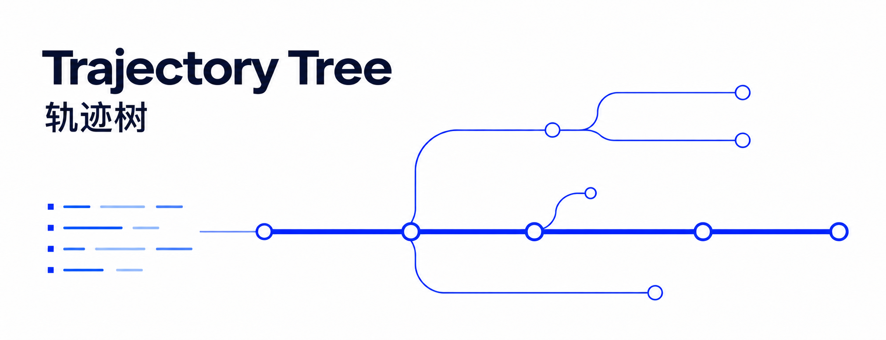
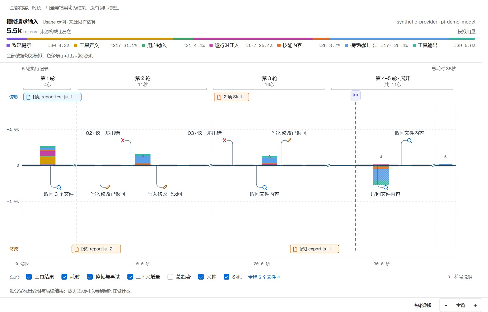
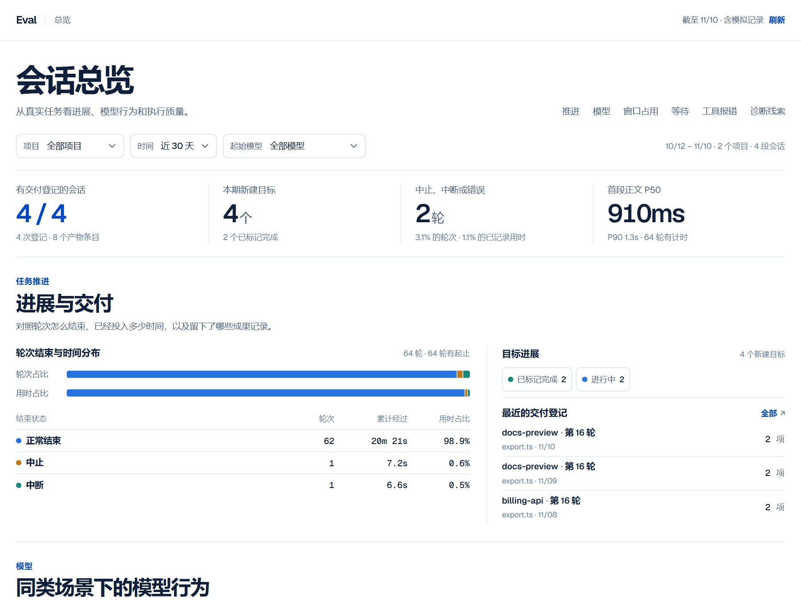
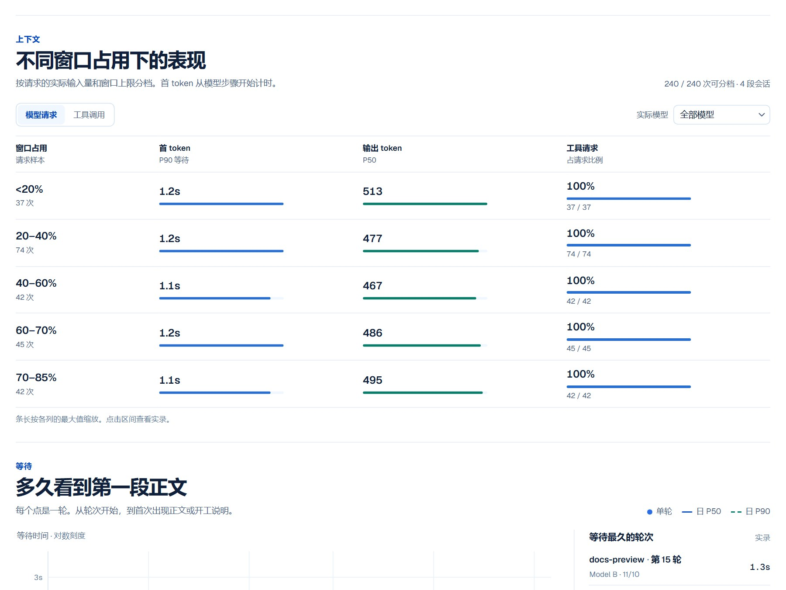
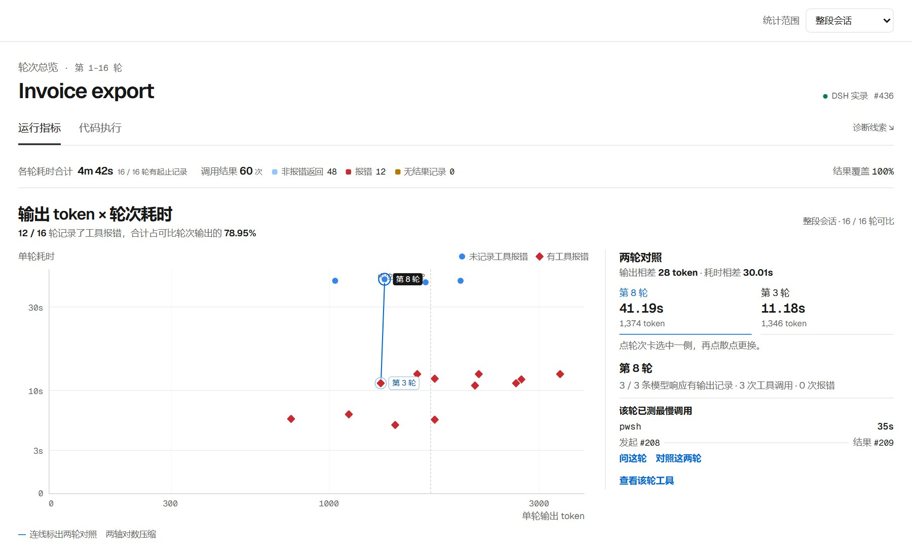
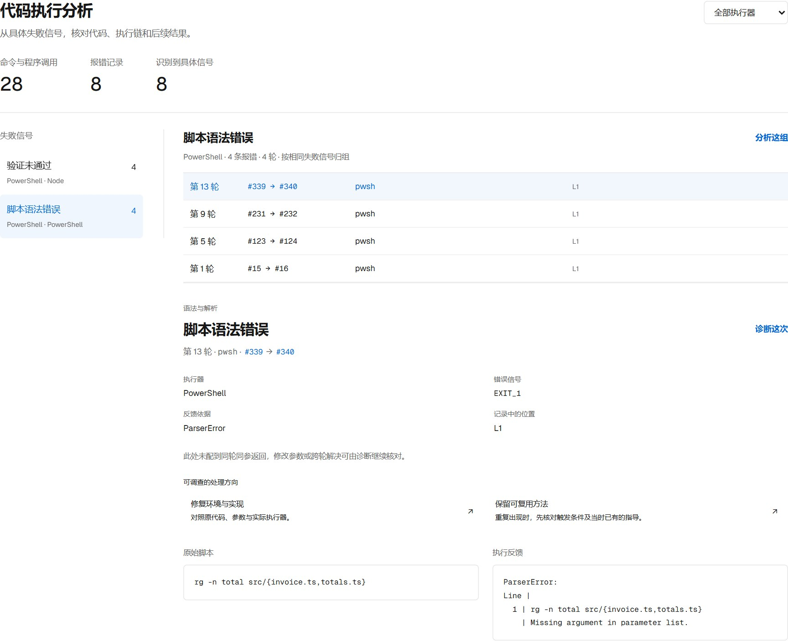
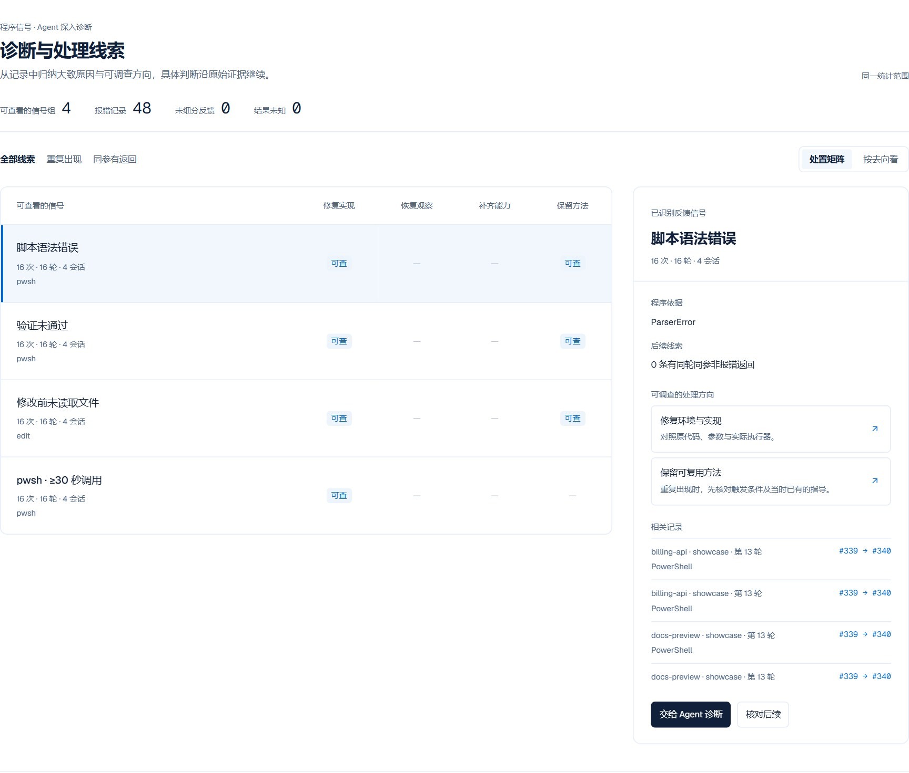
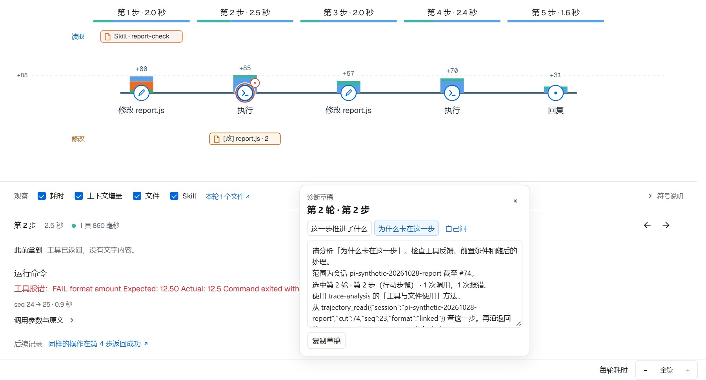
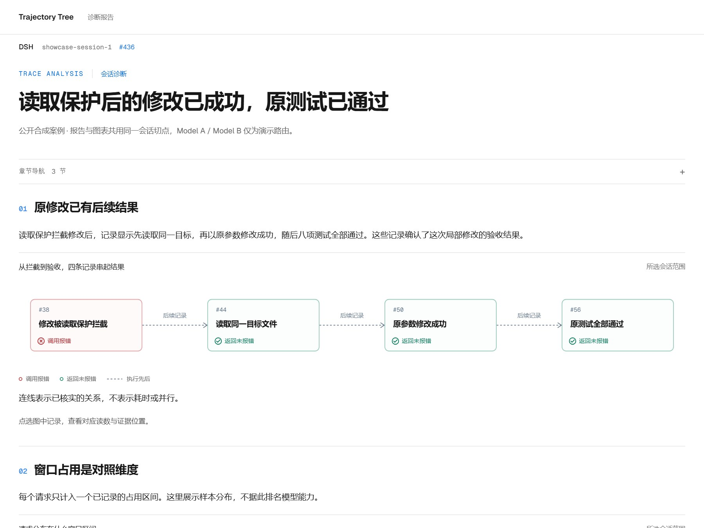

<h1 align="center"></h1>

<p align="center"><strong>从对话日志，看见 Agent 怎样工作。</strong></p>
<p align="center">轨迹树 · Eval · 点选诊断 · 可视化报告</p>

<p align="center">
  <a href="README.en.md">English</a> ·
  <a href="#快速开始">快速开始</a> ·
  <a href="docs/host-entrypoints.md">宿主接入</a> ·
  <a href="LICENSE">MIT License</a>
</p>

<p align="center"><code>DSH</code> &nbsp; <code>Pi</code> &nbsp; <code>Codex</code> &nbsp; <code>Claude Code</code></p>

开发与审查：[PR 关系诊断与原生回归](docs/relation-ci.md)。

> 截图来自可复现的公开合成案例，不含私人对话。示例中的 Model A / B 用来演示模型对照。[素材与复现](docs/media/README.md)

## 轨迹树

把会话主线展开成工具和行动的枝条。从任意一轮查看参数、返回、文件变化、子代理关系和上下文增量，沿关联记录还原任务怎样推进。



## Eval

Eval 从日常任务的记录中提取指标，与轨迹树共用数据和切点，不需要另外跑 benchmark。单会话对照轮次耗时、输出量、工具延迟和错误分布；项目总览进一步汇集任务进展、模型行为和跨会话信号。

按项目、时间和模型筛选，再按窗口占用、输入量或工具交叉查看请求与执行指标。点选区间可以查看组成样本。DSH 总览先展示已读到的会话，随后逐步补齐，筛选和诊断选区会保留。



<details>
<summary>窗口占用的交叉对照与单会话指标</summary>





</details>

## 从失败信号追到具体执行

「代码执行」把 PowerShell、子程序与 PTC 的代码、宿主结果和反馈放在一起。按执行器和失败信号筛选，查看脚本位置、错误证据、父子调用和后续返回。能稳定识别的原因由程序归因，需结合任务与环境的问题继续交给 Agent 调查。



| 案例 | 可以查看的证据 |
| --- | --- |
| PowerShell 语法或参数出错 | 原始脚本、解析位置、外层退出码与具体反馈 |
| 修改被读取保护拦截 | 目标文件、后续读取、同参修改返回及验证记录 |
| PTC 中的一次子调用失败 | 外层程序、内层工具和各自的运行结果 |
| 高窗口占用时错误增多 | 相同模型、工具和占用区间的样本与报错分布 |

## 点选诊断

在 DSH 轨迹树上长按选中对象，按住后拖动可圈选，也可单选上下文增量柱。Eval 从图表详情发起诊断，也可以查 DSH 工具声明的来源与调用。选好问题后，页面生成带会话、选区和取证入口的草稿，编辑确认后再发送。

总览和单会话 Eval 还提供「诊断与处理线索」：程序按记录归组，并给出修复环境与实现、恢复观察、补齐能力、保留方法四种调查方向。它们可以组合，具体判断由 Agent 沿已有取证流程完成。同参返回只表示后续结果，不直接代表任务完成。



<details>
<summary>行动路径上的选区与可编辑草稿</summary>



</details>

## 调查之后，交付报告

报告把调查结论、同切点的 Eval 指标和原文证据组织到一起。可以用流程图串起行动、反馈与验收，用环形图展示构成，再用分布、趋势和表格比较不同维度。图表可点选查看记录和统计口径，生成的 HTML 可离线保存。



<details>
<summary>更多示例：上下文保留与装配</summary>

- [上下文趋势](docs/media/context-trend.jpg)：按来源看保留量和每轮增减。
- [上下文装配动图](docs/media/context-assembly.gif)：回放追加、保留和历史改写。
- [报告组件与写作方法](report/AUTHORING.md)：证据绑定、流程图、构成图、分布与趋势。

</details>

## 快速开始

从仓库根目录操作。插件包自身声明 Node.js 18+，但 DSH 0.2.2 起的宿主需要 Node.js 24.9+；其他宿主的工具与独立视图需要 Node.js 20+。

| 宿主 | 会话 Eval | 项目总览 | 代码执行 |
| --- | --- | --- | --- |
| DSH | 会话中的评估面板 | 左侧栏 Eval 总览 | 评估 → 代码执行 |
| Pi | `/trajectory --eval` | `/trajectory --overview` | `/trajectory --code` |
| Codex | `$trajectory-eval` | `$trajectory-eval --overview` | `$trajectory-eval --code` |
| Claude Code | `/trajectory-tree:trajectory-eval` | `/trajectory-tree:trajectory-eval --overview` | `/trajectory-tree:trajectory-eval --code` |

Pi、Codex 和 Claude Code 的轨迹生成入口也接受 `--eval`、`--overview` 或 `--code`。DSH 直接使用常驻面板。[完整宿主入口](docs/host-entrypoints.md)

<details>
<summary><strong>DSH · 原生插件与分析面板</strong></summary>

```sh
npm pack ./plugin/trajectory-tools
npm pack ./plugin/analysis-view
dsh plugin --profile web add ./dsh-trajectory-tools-0.6.7.tgz ./dsh-analysis-view-0.10.147.tgz
```

重启 `dsh web`，在会话里打开「评估」或用 `/trajectory` 打开轨迹树。选好诊断问题后，点「填入对话」把草稿追加到当前输入框。插件面向 DSH 0.2.2 系列，逐包核对见[兼容与语言说明](docs/host-compatibility.md#dsh-version)。

在本机 DSH Web 的左侧栏打开「Eval 总览」，按项目查看推进、模型行为和工具报错，也可以按窗口占用区间对照模型请求与工具调用。

在路径总览中，点击目标线可查看对应目标。点击事件点可查看那次变更，并从详情进入对应轮次的行动路径或对话。
轨迹树从 DSH 会话记录估算七类请求构成，按轮和按步展示上下文变化。Eval 和取证工具使用同一批样本，宿主上报的输入量单列。

在 DSH 插件管理中打开「轨迹树」，可配置右侧栏的「对话搜索」、轨迹图层和 Eval 工具排序。搜索默认开启，覆盖整段会话，可翻到更早的命中并跳回对应轮次。DSH 的按需解读会调用当前模型。压缩后对账默认开启，可设 `config.reconcile: false` 关闭。

[分析面板](plugin/analysis-view/README.md) · [取证工具](plugin/trajectory-tools/README.md)

</details>

<details>
<summary><strong>Pi · 当前分支与原生命令</strong></summary>

```sh
npm ci --prefix plugin/portable-tools --ignore-scripts
pi -e ./plugin/portable-tools
```

使用 `/trajectory` 查看当前分支，或用 `/trajectory --eval` 打开 Eval。可复制 Pi 装填指令回终端；如果输入框已有草稿，可以复制提示词正文并自行合并。`trace-analysis` 分析会话过程，`context-profile` 查看当前上下文与工具配置。

[Pi 使用说明](plugin/portable-tools/README.md#pi)

</details>

<details>
<summary><strong>Codex · 插件、MCP 与独立视图</strong></summary>

```sh
npm ci --prefix plugin/portable-tools --ignore-scripts
node scripts/sync-host-skills.mjs
node scripts/package-trajectory.mjs --host codex
```

从本地插件目录安装 `dist/trajectory-tree-codex`。使用 `$trajectory-view` 打开轨迹树，`$trajectory-eval` 打开 Eval，或用 `$trace-analysis` 和 `$context-profile` 分析。Eval 草稿可复制回 Codex 输入框。

也可以直接生成当前会话视图；读取本机会话需要官方 `codex app-server`：

```sh
node scripts/trajectory-view.mjs --host codex --serve
```

可以用 `trajectory_command_diagnose` 从同一切点细查命令归因。PowerShell 语法补查支持 Windows PowerShell 5.1 和 PowerShell 7。 [命令诊断入口](docs/host-entrypoints.md#命令诊断)

从动作或文件历史打开「改动对比」，可以按文件查看记录中的增删行、原／新行号和原始补丁。

[插件入口](docs/host-entrypoints.md) · [Codex / MCP 配置](plugin/portable-tools/README.md#codex)

</details>

<details>
<summary><strong>Claude Code · 原生插件与 transcript</strong></summary>

```sh
npm ci --prefix plugin/portable-tools --ignore-scripts
node scripts/sync-host-skills.mjs
node scripts/package-trajectory.mjs --host claude
claude --plugin-dir ./dist/trajectory-tree-claude
```

使用 `/trajectory-tree:trajectory-view` 或 `/trajectory-tree:trajectory-eval` 打开视图，再把诊断草稿复制回 Claude Code。插件在会话启动、恢复等时机提供当前 transcript 路径。

[Claude Code 使用说明](plugin/claude/README.md)

</details>

### 离线生成视图

```sh
node scripts/trajectory-view.mjs --host pi --file /absolute/session.jsonl --open
node scripts/trajectory-view.mjs --host claude --file /absolute/transcript.jsonl --eval --lang zh-CN --open
```

生成过程不调用模型。命令返回独立 HTML 文件和本地预览地址；页面包含字体，可离线保存。

轨迹树、Eval 和诊断草稿默认跟随宿主或浏览器语言。可在轨迹树中切换“自动 / 中文 / English”，也可加 `--lang en` 或 `--lang zh-CN` 固定独立视图的语言。日志原文、路径和参数保持原样。各宿主的功能与证据边界见[兼容与语言说明](docs/host-compatibility.md)。

## 同一组取证工具

| 工具 | 用途 |
| --- | --- |
| `trajectory_inspect` | 查看过程、耗时、用量、反复尝试、工具文件和上下文统计 |
| `trajectory_search` | 定位会话、字面记录与统计范围 |
| `trajectory_read` | 查看原文、关联动作与反馈，分段追读完整参数和结果 |
| `trajectory_graph` | 查看记录关系与会话谱系 |

`trajectory_inspect` 可按结果筛选工具调用。下面按工具统计明确报错。将 `outcome` 改为 `abnormal` 也会纳入结果未确认的调用。

```json
{"view":"io","groupBy":"tool","outcome":"error","sort":"count"}
```

查询只读。各宿主按已有记录提供证据，不把未记录的内容补成事实。

| 宿主 | 主要数据来源 |
| --- | --- |
| DSH | 原生事件与官方统计投影、上下文构成、文件、Skill 和子代理记录 |
| Pi | 选中分支、当前 SDK 配置及采集到的工具执行时间 |
| Codex | 官方会话读取接口，以及对应线程的本地记录补充 |
| Claude Code | 明确选定的 transcript、原生工具参数与结果、已记录的消息用量 |

## 文档

- [功能索引](docs/INDEX.md) · [代码语义地图](docs/code-map.md) · [历史归档](docs/archive/README.md)
- [宿主接入与命令](docs/host-entrypoints.md)
- [工具配置、查询与正文续读](plugin/portable-tools/README.md)
- [分析方法](skill/trace-analysis/SKILL.md) · [上下文与配置剖面](skill/context-profile/SKILL.md)
- [HTML 报告组件用法](report/AUTHORING.md)

<details>
<summary>开发与自检</summary>

```sh
node scripts/sync-host-skills.mjs --check
node scripts/sync-view-assets.mjs --check
npm test --prefix plugin/trajectory-tools
npm test --prefix plugin/portable-tools
node plugin/analysis-view/presentation-test.mjs
node plugin/analysis-view/perf-test.mjs
```

`plugin/` 提供宿主接入，`analyzers/` 处理原生记录，`view/` 与 `report/` 提供视图和报告组件。公开展示素材可由 `node scripts/build-readme-media.mjs --serve 3099` 重现。

</details>

## 许可证

[MIT](LICENSE) © 2026 goatliamia

轨迹树和 Eval 随附由 Vercel 与 basement.studio 合作制作的 Geist Sans 和 Geist Mono，字体采用 SIL Open Font License 1.1。[Geist 官网](https://vercel.com/font) · [随附的字体许可证](plugin/analysis-view/lib/trace/fonts/LICENSE.txt)
