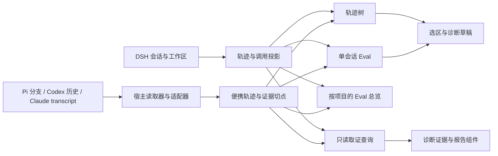

# 代码语义地图

## 记录如何到达用户

| 入口 | 关键语义 | 源码位置 |
| --- | --- | --- |
| DSH 路径页 | 用版本化切点加载阶段数据，子会话与细节按需读取 | [宿主路由](../plugin/analysis-view/lib/index.js) · [阶段与资源](../plugin/analysis-view/lib/trace-stages.js) |
| DSH 总览 | 工作区清单决定会话范围，观察版本决定缓存，当前切点投影调用和上下文 | [总览服务](../plugin/analysis-view/lib/eval/overview/service.mjs) · [数据投影](../plugin/analysis-view/lib/eval/overview/data.mjs) |
| 便携入口 | Pi 保留分支，Codex 读官方历史并关联匹配的 rollout，Claude 使用明确选中的 transcript | [CLI](../scripts/trajectory-view.mjs) · [单会话装配](../view/generate.mjs) · [项目总览](../view/overview.mjs) |
| 原文与切点 | 读取与查询使用相同快照标识。报错、同参返回和未知结果来自配对的证据 | [便携切点](../plugin/portable-tools/sources.mjs) · [DSH 关联读取](../plugin/trajectory-tools/lib/linked-read.js) |
| 页面、语言、报告 | 宿主适配放在入口。界面文字和原始日志分开，生成包保留字体、模板和声明的依赖 | [总览装配](../plugin/analysis-view/lib/eval/overview/render.mjs) · [语言运行时](../lib/i18n.mjs) · [报告绑定](../report/AUTHORING.md) |

## CR 看到的值依赖

本次发布检查用本地 Code Relations 的 `ts_file_value_dependencies` 扫描产品源码和构建脚本。扫描包括当前工作树新增的总览源码，排除依赖安装目录、生成包、夹具、浏览器导出和本机会话。以输出中的 `source → target` 表示引用方到被引用方。

- `scripts/trajectory-view.mjs` 和 `plugin/portable-tools/pi.mjs` 都进入 `view/overview.mjs`。便携投影读取 `sources.mjs` 和 `usage.mjs`，再把紧凑数据交给共用总览模板。
- `plugin/analysis-view/lib/index.js` 连接总览服务与页面装配。服务依赖 `trace-cache.js` 的观察版本，数据投影依赖 `trace-build.js` 和原生请求用量。
- DSH 和便携都使用总览的 `shared.mjs` 处理路由编号和报错配对。便携入口直接依赖页面装配和纯统计模块，DSH 的 Web 服务和 SDK 重放留在宿主侧。
- `io-outcome.js`、`trace-build.js`、`sources.mjs` 与语言资源被多处使用。改动这些文件时，影响会到达报告、查询或打包入口，适合同时跑宿主夹具和独立解包测试。

本次 CR 结果覆盖 197 个源码文件，记录 307 条内部值依赖，状态为 `partial-interpretation`。动态宿主服务、浏览器注入和字符串拼接的资源路径，由路由、浏览器与包验收覆盖。复跑入口见[关系诊断](relation-ci.md)，本机发布检查把编译范围和原始输出保存在 `.dsh/`。
