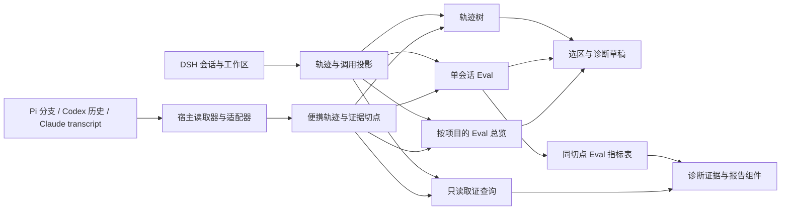

# 代码语义地图

## 记录如何到达用户

| 入口 | 关键语义 | 源码位置 |
| --- | --- | --- |
| DSH 路径页 | 用版本化切点加载阶段数据，子会话与细节按需读取 | [宿主路由](../plugin/analysis-view/lib/index.js) · [阶段与资源](../plugin/analysis-view/lib/trace-stages.js) |
| DSH 总览 | 版本化摘要先查缓存，原始记录在低优先级队列中逐个投影；首批即展示，后续批次保留筛选和记录身份 | [总览服务](../plugin/analysis-view/lib/eval/overview/service.mjs) · [数据投影](../plugin/analysis-view/lib/eval/overview/data.mjs) · [分批装配](../plugin/analysis-view/lib/eval/overview/app.js) |
| 便携入口 | Pi 保留分支，Codex 读官方历史并关联匹配的 rollout，Claude 使用明确选中的 transcript | [CLI](../scripts/trajectory-view.mjs) · [单会话装配](../view/generate.mjs) · [项目总览](../view/overview.mjs) |
| 原文与切点 | 读取与查询使用相同快照标识。报错、同参返回和未知结果来自配对的证据 | [便携切点](../plugin/portable-tools/sources.mjs) · [DSH 关联读取](../plugin/trajectory-tools/lib/linked-read.js) |
| 诊断线索与代码执行 | 共用调用和失败证据，按来源、轮次归组；程序提供调查方向，草稿分来源列出取证查询 | [信号规则](../plugin/analysis-view/lib/eval/findings.mjs) · [代码投影](../plugin/analysis-view/lib/eval/code-data.mjs) · [草稿](../plugin/analysis-view/lib/eval/diagnosis.js) |
| 最终报告 | 从冻结的 Eval 表组织结论；流程图的节点和连线显式绑定证据，构成、趋势和表格保留原统计范围 | [指标表](../report/evaluation.mjs) · [流程图](../report/flow.mjs) · [报告写作](../report/WRITING.md) |
| 页面、语言、报告 | 宿主适配放在入口。界面文字和原始日志分开，生成包保留字体、模板和声明的依赖 | [总览装配](../plugin/analysis-view/lib/eval/overview/render.mjs) · [语言运行时](../lib/i18n.mjs) · [报告绑定](../report/AUTHORING.md) |

## 当前读数

固定快照见[代码状态](code-status.md)，本轮复核见[扫描与处理记录](code-scan-review.md)。2026-11-16 对提交 `c55ab07` 扫描 392 个受管 JS / MJS 文件、48,009 行、11,372 个函数或方法，得到 670 对文件级值引用候选。

正式 UI 的两组 `docs/demo/` 源码纳入维护范围；轨迹页、模型与共享资源、Eval workspace、当前上下文安装资源作为生成副本单独计量，不进入手写函数排名。旧的 215 文件快照与本次范围不同，不能直接按总量增长判断退化。

主要依赖方向按文件对计：

- `scripts` → `plugin/analysis-view`：53 对。
- `scripts` → `analyzers`：30 对。
- `scripts` → `report`：14 对。
- `scripts` → `lib`：13 对。
- `scripts` → `view`：12 对。
- `view` → `plugin/analysis-view`：11 对。
- `analyzers` → `lib`：10 对。

手写单元的前三个复杂度维护点：

- `projectPresetContext`（190）：`analyzers/preset-context.mjs:20`。
- `adaptPiSession`（182）：`analyzers/pi-adapter.mjs:77`。
- `<匿名>`（160）：`analyzers/codex-adapter.mjs:202`。

圈复杂度衡量显式分支结构，不是 CPU 或卡顿测量。当前文件值引用图和静态模块请求图未观察到多文件环；此结果不替代函数递归、动态宿主调用或浏览器拼装世界的分析。

## 扫描口径

- CR 先解析模块清单，再按所选静态依赖闭包分批收集文件值依赖、未读绑定和初始化/字段排除角色；当前范围 39 个上下文。
- 扫描结果绑定实际来源哈希、编译器及引擎。未读名字与缺少外部实现分别复核，不作为删除代码或运行错误的自动判定。
- 手写复杂度由 TypeScript 语法树复算，生成前以固定的 10 单元 CR 基线核对。正式 UI 的全局片段与动态宿主仍有上下文边界。
- 只在显式运行 [code-status.mjs](../scripts/code-status.mjs) 时扫描，不加入 Eval 打开路径或 DSH 启动。九项 PR 保证另见[关系诊断](relation-ci.md)。

## 当前上下文与界面资源

DSH `/context-map` 打开右侧栏当前保留上下文；原生保留面 → `request-context.js` → `CurrentContextService` → 分类缩放模型与画布，正文按快照版本懒读。分类沿用轨迹图七类，压缩后只呈现保留内容。源码、缓存边界及压力测量口径见[当前上下文侧栏](current-context-sidebar.md)。

Eval 的处置矩阵把数量、窗口与观察指标直接编码进主图；配置重合结果保持展开，历史请求与当前配置分开取证。作者界面文案在资源同步时接入语言层，原文插值不翻译；画布与 DOM 共用本地字体变量。
