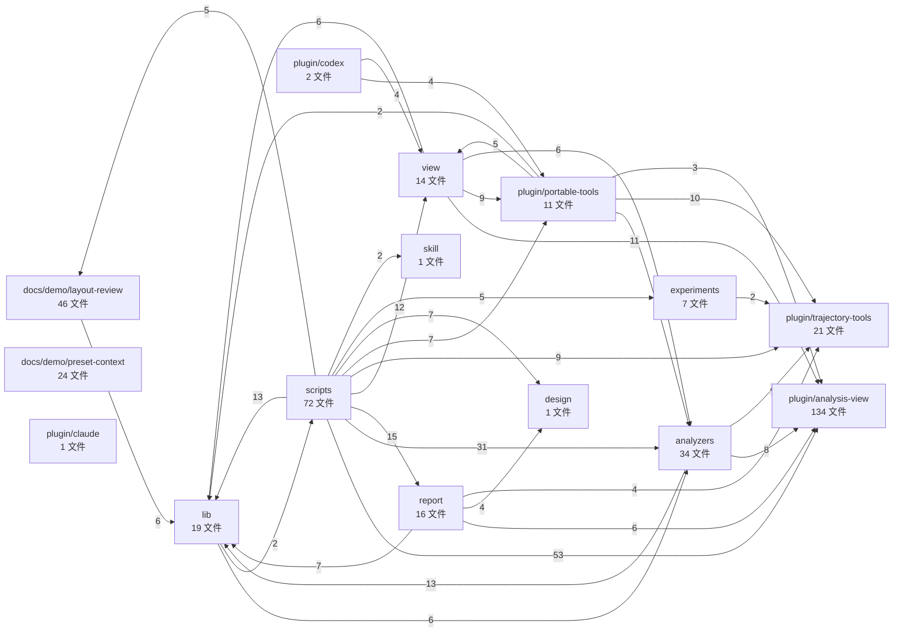

# 代码状态

<!-- 由 scripts/code-status.mjs 生成，请勿手改。 -->

快照：2026-11-17 · 提交 `096ef50` · 含未提交改动

源码面：403 个文件 · 49,381 行 · 11,615 个函数或方法

依赖：688 对文件级值依赖 · 38 组跨模块方向 · 12 组模块内部方向

复杂度：圈复杂度合计 41,747，其中手写部分 27,757 · 中位数 1 · 最高 190

## 模块

| 模块 | 文件 | 行 | 函数 | 圈复杂度 | 单文件最高 | 扇入 | 扇出 |
| --- | ---: | ---: | ---: | ---: | ---: | ---: | ---: |
| `plugin/analysis-view` | 134 | 22,804 | 5,544 | 20,026 | 4,431 | 109 | 71 |
| `docs/demo/layout-review` | 46 | 5,671 | 1,552 | 4,985 | 330 | 5 | 7 |
| `scripts` | 72 | 4,438 | 887 | 2,193 | 154 | 12 | 49 |
| `plugin/trajectory-tools` | 21 | 3,921 | 623 | 3,007 | 613 | 20 | 7 |
| `analyzers` | 34 | 3,443 | 781 | 3,463 | 463 | 29 | 19 |
| `lib` | 19 | 2,341 | 173 | 759 | 200 | 19 | 5 |
| `docs/demo/preset-context` | 24 | 1,895 | 832 | 3,021 | 407 | 22 | 12 |
| `report` | 16 | 1,688 | 525 | 1,876 | 381 | 14 | 13 |
| `view` | 14 | 1,622 | 343 | 1,084 | 242 | 7 | 6 |
| `plugin/portable-tools` | 11 | 1,021 | 290 | 1,114 | 313 | 10 | 10 |
| `experiments` | 7 | 443 | 54 | 181 | 91 | 2 | 3 |
| `design` | 1 | 45 | 5 | 19 | 19 | 1 | 0 |
| `plugin/codex` | 2 | 32 | 6 | 19 | 14 | 1 | 2 |
| `plugin/claude` | 1 | 11 | 0 | 0 | 0 | 0 | 0 |
| `skill` | 1 | 6 | 0 | 0 | 0 | 1 | 0 |
| **合计** | **403** | **49,381** | **11,615** | **41,747** | | | |

扇入、扇出按文件计：模块内至少有一个文件被别的文件依赖，或被依赖，就计一次。

轨迹页及模型/共享资源、Eval workspace 与当前上下文安装资源是生成副本，计入发行体量，但不进手写函数与文件排名。正式 UI 的 `docs/demo/layout-review/` 与 `docs/demo/preset-context/` 源码参与排名。

## 模块依赖



图上画 33 组至少两对文件的跨模块依赖；下表按文件对列出前 12 组。

另有 5 组只有一对文件，未画入图：`lib → plugin/trajectory-tools`、`plugin/analysis-view → lib`、`lib → plugin/analysis-view`、`analyzers → experiments`、`scripts → docs/demo/preset-context`。

| 依赖 | 文件对 | 见证 | 例子 |
| --- | ---: | ---: | --- |
| `scripts` → `plugin/analysis-view` | 53 | 334 | `scripts/build-readme-media.mjs → plugin/analysis-view/lib/index.js`；`scripts/build-readme-media.mjs → plugin/analysis-view/lib/trace/fonts.mjs` |
| `scripts` → `analyzers` | 31 | 322 | `scripts/build-readme-media.mjs → analyzers/pi-sample.mjs`；`scripts/dsh-management-config.mjs → analyzers/preset-current.mjs` |
| `scripts` → `report` | 15 | 74 | `scripts/build-readme-media.mjs → report/compile.mjs`；`scripts/build-readme-media.mjs → report/render.mjs` |
| `analyzers` → `lib` | 13 | 64 | `analyzers/claude-adapter.mjs → lib/tool-control.mjs`；`analyzers/claude-reader.mjs → lib/bounded-file.mjs` |
| `scripts` → `lib` | 13 | 54 | `scripts/dsh-management.mjs → lib/dsh-skill-catalog.mjs`；`scripts/dsh-management.mjs → lib/lifecycle-observation.mjs` |
| `scripts` → `view` | 12 | 44 | `scripts/build-readme-media.mjs → view/render.mjs`；`scripts/trajectory-report.mjs → view/eval.mjs` |
| `view` → `plugin/analysis-view` | 11 | 58 | `view/render.mjs → plugin/analysis-view/lib/eval/render.mjs`；`view/render.mjs → plugin/analysis-view/lib/trace/fonts.mjs` |
| `plugin/portable-tools` → `analyzers` | 10 | 112 | `plugin/portable-tools/sources.mjs → analyzers/claude-adapter.mjs`；`plugin/portable-tools/sources.mjs → analyzers/claude-reader.mjs` |
| `plugin/portable-tools` → `plugin/trajectory-tools` | 10 | 64 | `plugin/portable-tools/sources.mjs → plugin/trajectory-tools/lib/tool-attribution.js`；`plugin/portable-tools/analysis.mjs → plugin/trajectory-tools/lib/io-outcome.js` |
| `scripts` → `plugin/trajectory-tools` | 9 | 34 | `scripts/report-fixture-source.mjs → plugin/trajectory-tools/lib/index.js`；`scripts/build-preserved-demo.mjs → plugin/trajectory-tools/lib/tool-attribution.js` |
| `view` → `plugin/portable-tools` | 9 | 48 | `view/eval.mjs → plugin/portable-tools/sources.mjs`；`view/eval.mjs → plugin/portable-tools/usage.mjs` |
| `analyzers` → `plugin/analysis-view` | 8 | 144 | `analyzers/cr-pwsh.mjs → plugin/analysis-view/lib/trace/shared/pwsh-observer.mjs`；`analyzers/eval-insights.mjs → plugin/analysis-view/lib/eval/diagnostic-rules.mjs` |

模块内部依赖 392 对，占全部文件对的 57%。

## 复杂度

分布与排名只看手写单元。

| 圈复杂度 | 函数 |
| --- | ---: |
| 1–5 | 6,899 |
| 6–10 | 527 |
| 11–20 | 317 |
| 21–40 | 119 |
| 41+ | 60 |

最高的函数或方法：

| 单元 | 位置 | 圈复杂度 | 行 |
| --- | --- | ---: | ---: |
| `projectPresetContext` | `analyzers/preset-context.mjs:20` | 190 | 148 |
| `adaptPiSession` | `analyzers/pi-adapter.mjs:78` | 184 | 100 |
| `<匿名>` | `analyzers/codex-adapter.mjs:203` | 161 | 118 |
| `bindFigure` | `report/contract.mjs:40` | 130 | 86 |
| `describeCall` | `docs/demo/layout-review/step-insight.mjs:43` | 127 | 110 |
| `renderOverview` | `docs/demo/layout-review/base/branches.js:36` | 112 | 153 |
| `projectFindingCalls` | `plugin/analysis-view/lib/eval/findings.mjs:7` | 96 | 41 |
| `call` | `plugin/portable-tools/service.mjs:53` | 96 | 98 |
| `describeOperation` | `docs/demo/layout-review/tool-operation-model.mjs:68` | 94 | 57 |
| `handler` | `plugin/analysis-view/lib/index.js:609` | 94 | 225 |
| `buildInjectionIndex` | `analyzers/context-evidence.mjs:54` | 92 | 106 |
| `buildInspection` | `plugin/trajectory-tools/lib/inspect.js:118` | 86 | 118 |

复杂度合计最高的文件：

| 文件 | 函数 | 合计 | 行 |
| --- | ---: | ---: | ---: |
| `plugin/analysis-view/lib/client.js` | 299 | 944 | 1,923 |
| `plugin/analysis-view/lib/eval/overview/app.js` | 382 | 931 | 1,301 |
| `plugin/trajectory-tools/lib/index.js` | 100 | 613 | 1,334 |
| `plugin/analysis-view/lib/index.js` | 87 | 486 | 835 |
| `analyzers/codex-adapter.mjs` | 66 | 463 | 342 |
| `plugin/trajectory-tools/lib/inspect.js` | 125 | 449 | 411 |
| `docs/demo/preset-context/controller.js` | 99 | 407 | 242 |
| `report/components.mjs` | 143 | 381 | 259 |
| `plugin/analysis-view/lib/trace-context.js` | 74 | 369 | 295 |
| `plugin/analysis-view/lib/eval/dashboard.js` | 135 | 338 | 735 |

## 口径与边界

- 源码面是 git 跟踪的 `analyzers/`、`design/`、`experiments/`、`lib/`、`plugin/`、`report/`、`scripts/`、`skill/`、`view/`、`docs/demo/layout-review/`、`docs/demo/preset-context/` 下的 `.js` 与 `.mjs`，排除测试、fixtures、dist、node_modules 与 `tmp-*`。
- 依赖取 `ts_file_value_dependencies`：值引用经声明落到文件，见证数表示支撑该文件对的引用条数。模块请求与投影路径另计，不并入这里。
- 圈复杂度按 ESLint classic 口径：每个函数以 1 为基线，显式判定、逻辑运算、可选链和带初值的参数各加一。嵌套函数单独计算。
- 「手写部分」指排除生成副本后的圈复杂度合计，与函数排名使用同一批单元。
- 本次生成前用引擎基线核对了 10 个单元，口径一致才写出本页。
- 另有 398 条静态模块请求指向外部或未纳入的来源（`partial-interpretation`），包括 Node 内建库与宿主 SDK；不是 398 个缺陷，也不表示不存在依赖。
- CR 按每个消费者的完整所选静态 import/export 闭包分批观察；动态分派和浏览器拼装脚本的运行时全局关系未供给。未读绑定只是复核线索，不直接判定可删除。
- 分析只读源码，不执行项目代码。

复跑：

```sh
node scripts/code-status.mjs --engine ../code-relations
```

本页是显式运行脚本得到的固定快照，不在 Eval 打开或宿主启动时扫描。
