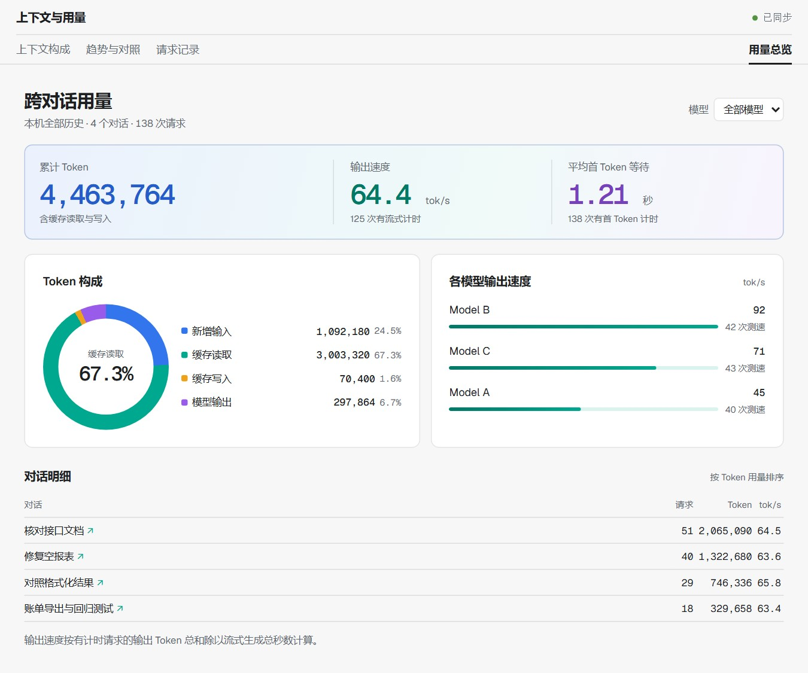

# Antigravity · 上下文与用量

Antigravity 的独立前端插件。在会话顶部的 `+` 菜单打开「上下文与用量」，查看最近请求的上下文来源、实报 Token、缓存及压缩切点。沿用轨迹树的七类内容和连续缩放矩阵，支持搜索、拖动、双击聚焦及按需读取正文。

此接入只提供侧栏页面，不注册模型工具、MCP、skill 或 `/ctx` 命令。完整轨迹树、Eval 和诊断工具仍由 [DSH、Pi、Codex 与 Claude Code 接入](../../docs/host-entrypoints.md)提供。

打开「用量总览」可统计本机全部历史对话，按模型筛选累计 Token、流式输出速度和平均首 Token 等待时间。环形图展示用量构成，横条图对照模型速度，点选对话名称可回到该对话的请求详情。



## 安装

本机需要 Node.js 24+，`sidecar_sdk` 由 Antigravity 提供。将 ZIP 中的 `trajectory-tree` 目录解压到 `~/.gemini/config/plugins/`，然后刷新插件。[下载 Antigravity 1.1.0 安装包](https://github.com/goatliamia/trajectory-tree/releases/download/v0.2.7/trajectory-tree-antigravity-1.1.0.zip)

也可以从仓库根目录运行安装脚本。

```sh
node scripts/install-antigravity.mjs
```

默认安装到 `~/.gemini/config/plugins/trajectory-tree`，在宿主刷新插件或重启后启用。也可以用 `--dest <plugin-directory>` 指定插件目录。安装器只复制前端运行文件；不写宿主配置或会话记录，不另外安装同名全局 sidecar。

旧开发版若曾单独复制到 `~/.gemini/config/sidecars/context_board` 或 `~/.gemini/config/skills/ctx`，这些是独立安装项。迁移时移除确认属于旧原型的副本，避免显示两个面板或继续加载旧 `/ctx`；安装器只清理目标插件目录内能确认来自本项目的旧 skill。

## 数据口径

| 显示 | 来源与含义 |
| --- | --- |
| 上下文矩阵 | `conversations/<id>.db` 的 `gen_metadata`：最近请求中的 `system_prompt`、`prompt_sections`、`tools` 与 `message_prompts` |
| 七类划分 | 沿用轨迹树分类；系统分段去重，Skill catalog 与实际读取的 Skill 正文有不同名称，工具结果按精确调用 ID 关联 |
| 面积与占比 | 可见来源文本的 Token 估算；不分摊实报输入，不计思考、签名、媒体和服务商封装 |
| 请求输入 | 宿主记录的 `input_tokens + cache_read_tokens + cache_write_tokens`，与来源文本估算分开显示；不表示窗口容量或占用率 |
| 累计缓存命中 | 各请求的缓存读取量 / 累计请求输入；未记录时显示未知 |
| 跨对话累计 Token | 实报新增输入、缓存读取、缓存写入和输出之和；每个请求的已记录分项各计一次。优先使用原生请求库，缺少可读请求库时使用该对话的 transcript |
| 分叉与副本 | 有宿主响应标识的请求跨对话去重，优先归入父对话。缺少标识的旧记录按各自对话统计 |
| 输出速度 | 同时有实报输出和正数 `streaming_duration` 的请求，其输出 Token 之和除以流式生成秒数之和。页面显示计时样本数 |
| 首 Token 等待 | 对宿主记录的 `time_to_first_token` 取算术平均。各指标独立显示样本数，缺少计时时显示「—」 |
| 趋势与压缩对照 | 按请求记录用量，相邻请求净变化保留负值；不是某一次工具调用的因果贡献 |
| 原文 | 读取矩阵同版本、同会话的精确片段；快照更新后返回过期状态，不用另一个会话或截断预览冒充正文 |

当前宿主会裁掉旧请求的完整提示，保留最近请求的完整内容和历史请求用量。矩阵据此显示「最近请求」，不把最后一次响应和后续工具结果提前加入请求来源。完整提示缺失时，矩阵显示不可用；仍可显示 transcript 中已有的用量。宿主绑定会话时默认打开该会话；没有绑定时默认打开「用量总览」，可以点选对话进入详情。

单对话视图每 1.5 秒检查更新。用量总览首次打开时读取本机历史，之后每 15 秒检查一次文件版本，复用未变化对话的统计。页面隐藏后暂停。总览缓存只含请求标识、模型、计数和时长。单对话的正文快照最多保留四个，按需读取。

## 维护

```sh
node scripts/sync-antigravity.mjs
node scripts/sync-antigravity.mjs --check
node --test scripts/antigravity-test.mjs
```

`app.src.js` 与 `styles.base.css` 是侧栏源码。同步脚本从 `view/current-context/`、共用缩放组件及轨迹分类生成 `app.js`、`styles.css`、分类和字体；共享面板的运输适配有明确匹配校验，源代码变化时不会静默生成失效页面。`--build-only`（旧名 `--stage-only`）只构建，不写入用户插件目录。

本机验证结果与真实会话快照保存在忽略的 `.dsh/` 中，不随插件发布。字体使用 [SIL OFL 1.1](sidecars/context_board/fonts/LICENSE.txt)。
